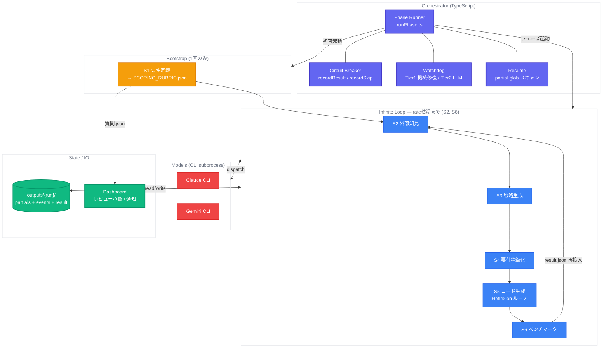

<p align="center">
  
  
  
  
  
</p>

<h1 align="center">Taikai-killer</h1>

<p align="center">
  <strong>大会で勝つために、寝ている間も戦略を進化させ続ける自律 AI ハーネス</strong>
</p>

<p align="center">
  大会要項を渡すと、要件抽出 → 外部知見収集 → 戦略立案 → コード生成 → 評価 を<br>
  レート枯渇まで無限ループで回し、結果をフィードバックに戦略を世代交代させ続ける。
</p>

<p align="center">
  Built on
  <a href="https://github.com/NyxFoundation/speca">speca</a> (orchestrator) &bull;
  <a href="https://github.com/Codium-ai/AlphaCodium">AlphaCodium</a> (test-anchored flow) &bull;
  <a href="https://github.com/faveos8758/reflexion-agent-ts">Reflexion</a> (self-improve) &bull;
  <a href="https://github.com/google-deepmind/funsearch">FunSearch</a> (evolution)
</p>

> [!NOTE]
> **これは設計フェーズのリポジトリです。** 実装の正は [`docs/`](./docs/README.md)、確定事項は [docs/decisions.md](./docs/decisions.md)。
> シンギュラリティバトルクエスト＋ハッカソンを狙う。前提リスク（出場資格 R1・サブスク自動化規約 R2・全自動提出 R3・通常マシン実行 R4）は[受任済み](./docs/decisions.md)。

---

## Overview

Taikai-killer は**1回だけのブートストラップ S1 ＋ 無限ループ S2〜S6** で動く自律パイプライン：

1. **S1 要件定義** — 大会ルールを抽出し、評価指標 `SCORING_RUBRIC.json` を**大会から導出**（一度きり）
2. **S2 外部知見** — 検索ワード生成 → クロール（論文は Semantic Scholar API）。最大4回 or 新規率<10%で早期終了
3. **S3 戦略生成** — 要件・知見・論文・ライバル予測から戦略を大量生成
4. **S4 要件精緻化** — 戦略ごとに要件を詰める
5. **S5 コード生成** — 戦略を実装し、テストを通すまで自己改善（Reflexion ループ）
6. **S6 ベンチマーク** — ルブリックで採点 → `result.json`。これを S2 に再投入して次の周回へ

1周 = 1 result。`result.json` をフィードバックに戦略を進化させ、レート枯渇まで回り続ける。

### 構成（2 codebase ＋ サイドカー）

| レイヤ | 言語 | 役割 |
|---|---|---|
| **Orchestrator** | TypeScript | フェーズ実行・並列ワーカー・resume・暴走/コスト制御（speca を移植） |
| **Dashboard** | TypeScript (React/Vite) | run 監視・結果可視化・ヒューマンレビュー承認（speca web/ を vendor） |
| **Crawl sidecar** | Python | Scrapling による外部知見クロール（TS から subprocess） |

### Key Capabilities

- **サブスク CLI 駆動** — Claude / Gemini の CLI を subprocess で叩く（従量課金なし）。フェーズ×モデルは config で指定
- **Partial = 唯一の真実源** — フェーズ間は中間 JSON 契約。Resume はディレクトリ glob だけ（状態 DB を持たない）
- **来歴(provenance)チェーン** — 全レコードが親 ID と元ソースを持ち、`result.json` から大会ルールまで JSON だけで遡れる
- **安全ガード（隔離の代わり）** — Circuit Breaker（`recordSkip` で待機を失敗に数えない）・2段自己修復（LLM cooldown）・コスト追跡
- **自己改善（D22 Reflexion）** — execute → evaluate → reflect → retry。テストアンカー回帰ガードで単調改善を強制
- **2トラック進化** — 数値（閾値/パラメータ）は LLM 不要のコードで最適化、構造（approach）は LLM が変異
- **学術的再現性** — 全 prompt/schema/親 partial の hash を固定、手続き的再現を担保

---

## Architecture



### セッションの進み方

```
S1(一度きり) ─▶ S2 ─▶ S3 ─▶ S4 ─▶ S5 ─▶ S6 ─▶ result.json ─┐
                ▲                                              │
                └──────────── 次の周回へ再投入 ────────────────┘
```

各周回は前回 `result.json` を見て前進：高得点の戦略を残し、進化させ、統合する。停止はレート枯渇・予算上限・暴走停止(CB)・ヒューマンレビューのみ。

---

## How the S5 Self-Improve Loop Works（D22 Reflexion）


- **失敗理由を全文注入**して再生成（盲目的リトライ禁止）。修正は構造化出力で受け `tsc --noEmit` 検証
- **テストを書く者 ≠ コードを書く者**。テストは S5 開始時に sha256 凍結、S6 が再ハッシュ検証（報酬ハック対策）

---

## Status / Roadmap

- ✅ **設計確定**：パイプライン全体・データ契約・オーケストレータ・受任リスク（[decisions.md](./docs/decisions.md)）
- ✅ **縦串MVP仕様**：1大会で1result出す最小経路を定義（[mvp-vertical-slice.md](./docs/mvp-vertical-slice.md)）
- 🔧 **実装中（未）**：`orchestrator/` TS 移植・`schemas/*.json` 実体化・縦串のコード化・dashboard server の TS 化
- 🔜 **次スコープ**：進化(island)・監査ハッシュチェーン・提出物 attestation・presentation 生成

## Docs

| ドキュメント | 内容 |
|---|---|
| [docs/README.md](./docs/README.md) | 設計の単一ソース・目次 |
| [architecture.md](./docs/architecture.md) | 全体図・データ契約・エラー経路 |
| [directory-structure.md](./docs/directory-structure.md) | 確定ディレクトリ構成 |
| [decisions.md](./docs/decisions.md) | 設計判断（L1-L9 / D1-D22 / 受任リスク R1-R4） |
| [mvp-vertical-slice.md](./docs/mvp-vertical-slice.md) | 縦串MVP仕様（致命的欠落を全部埋めた） |
| [steal-from-speca.md](./docs/steal-from-speca.md) / [integrations-issue1.md](./docs/integrations-issue1.md) | 外部OSSからの流用パターン |
| [execution-premise.md](./docs/execution-premise.md) / [troubleshooting.md](./docs/troubleshooting.md) | 実行前提・運用 Runbook |

---

<p align="center"><sub>設計の正は <code>docs/</code>。本 README は概観であり、矛盾時は docs/decisions.md を優先。</sub></p>
