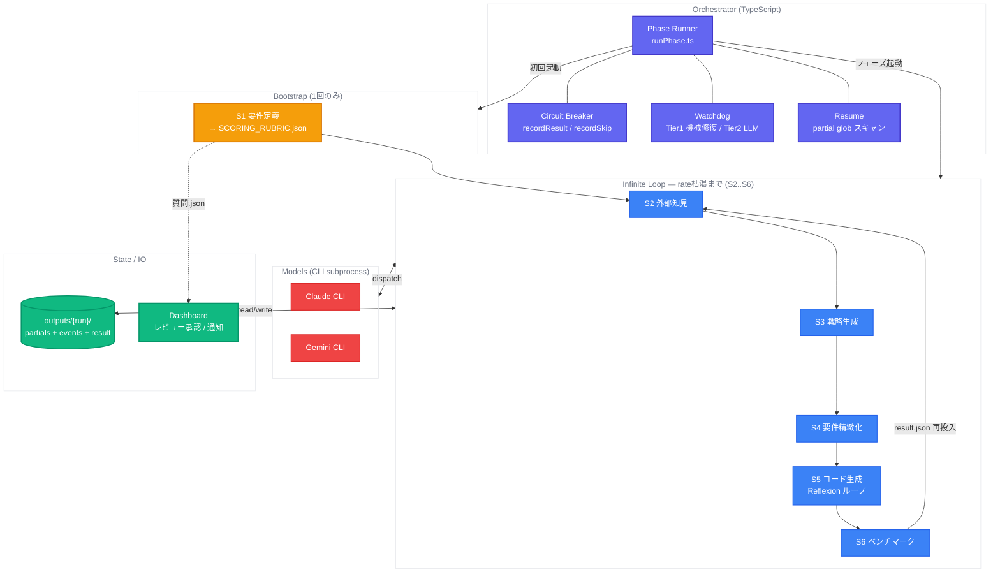
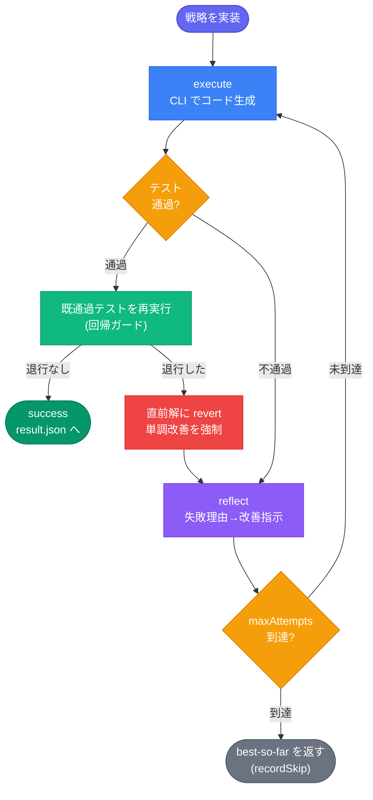

<p align="center">
  
  
  
  
  
</p>

<h1 align="center">Taikai-killer</h1>

<p align="center">
  <strong>大会で勝つために、寝ている間も戦略を進化させ続ける自律 AI ハーネス</strong>
</p>

<p align="center">
  大会要項を渡すと、要件抽出 → 外部知見収集 → 戦略立案 → コード生成 → 評価 を<br>
  レート枯渇まで無限ループで回し、結果をフィードバックに戦略を世代交代させ続ける。
</p>

<p align="center">
  Built on
  <a href="https://github.com/NyxFoundation/speca">speca</a> (orchestrator) &bull;
  <a href="https://github.com/Codium-ai/AlphaCodium">AlphaCodium</a> (test-anchored flow) &bull;
  <a href="https://github.com/faveos8758/reflexion-agent-ts">Reflexion</a> (self-improve) &bull;
  <a href="https://github.com/google-deepmind/funsearch">FunSearch</a> (evolution)
</p>

> [!NOTE]
> **これは設計フェーズのリポジトリです。** 実装の正は [`docs/`](./docs/README.md)、確定事項は [docs/decisions.md](./docs/decisions.md)。
> シンギュラリティバトルクエスト＋ハッカソンを狙う。前提リスク（出場資格 R1・サブスク自動化規約 R2・全自動提出 R3・通常マシン実行 R4）は[受任済み](./docs/decisions.md)。

---

## Overview

Taikai-killer は**1回だけのブートストラップ S1 ＋ 無限ループ S2〜S6** で動く自律パイプライン：

1. **S1 要件定義** — 大会ルールを抽出し、評価指標 `SCORING_RUBRIC.json` を**大会から導出**（一度きり）
2. **S2 外部知見** — 検索ワード生成 → クロール（論文は Semantic Scholar API）。最大4回 or 新規率<10%で早期終了
3. **S3 戦略生成** — 要件・知見・論文・ライバル予測から戦略を大量生成
4. **S4 要件精緻化** — 戦略ごとに要件を詰める
5. **S5 コード生成** — 戦略を実装し、テストを通すまで自己改善（Reflexion ループ）
6. **S6 ベンチマーク** — ルブリックで採点 → `result.json`。**2モード**: ①テスト通過型 ②**対戦型（戦略同士を対戦させ勝率で採点）**。これを S2 に再投入して次の周回へ

1周 = 1 result。`result.json` をフィードバックに戦略を進化させ、レート枯渇まで回り続ける。

### 構成（2 codebase ＋ サイドカー）

| レイヤ | 言語 | 役割 |
|---|---|---|
| **Orchestrator** | TypeScript | フェーズ実行・並列ワーカー・resume・暴走/コスト制御（speca を移植） |
| **Dashboard** | TypeScript (React/Vite) | run 監視・結果可視化・ヒューマンレビュー承認（speca web/ を vendor） |
| **Crawl sidecar** | Python | Scrapling による外部知見クロール（TS から subprocess） |

### Key Capabilities

- **サブスク CLI 駆動** — Claude / Gemini の CLI を subprocess で叩く（従量課金なし）。フェーズ×モデルは config で指定
- **Partial = 唯一の真実源** — フェーズ間は中間 JSON 契約。Resume はディレクトリ glob だけ（状態 DB を持たない）
- **来歴(provenance)チェーン** — 全レコードが親 ID と元ソースを持ち、`result.json` から大会ルールまで JSON だけで遡れる
- **安全ガード（隔離の代わり）** — Circuit Breaker（`recordSkip` で待機を失敗に数えない）・2段自己修復（LLM cooldown）・コスト追跡
- **自己改善（D22 Reflexion）** — execute → evaluate → reflect → retry。テストアンカー回帰ガードで単調改善を強制
- **2トラック進化** — 数値（閾値/パラメータ）は LLM 不要のコードで最適化、構造（approach）は LLM が変異
- **学術的再現性** — 全 prompt/schema/親 partial の hash を固定、手続き的再現を担保

---

## Usage / Quickstart

> [!NOTE]
> 全体（S1〜S6 の無限ループ・並列・進化）は**設計フェーズ**だが、**縦串MVP**（1大会で1 result を出す最小経路 S3→S5→S6）と各種ツールは**実際に動く**。ここに書くのは現時点で動く範囲のみ。

### 前提

- **Node.js >= 20**（`package.json` engines）。
- example の実行・採点には **Python 3**（同梱 example は `python` で test/対戦する）。
- `run` / `probe` だけは **`claude` CLI** がログイン済みで PATH にあること（subprocess で駆動）。`typecheck` / `test` / `evolve` / `dashboard` は **CLI 不要**。

### セットアップ

```bash
npm install        # 依存は ajv のみ（実行は tsx / vitest / typescript）
npm run typecheck  # tsc --noEmit（strict / NodeNext）。exit 0 で型OK
npm test           # vitest run — 333 tests / 25 files（純ロジックのみ）
```

### CLI コマンド一覧

`npm run taikai -- <cmd>`（= `tsx orchestrator/index.ts <cmd>`）。

| コマンド | 役割 | LLM CLI |
|---|---|---|
| `probe` | D4 検証: `claude` CLI が driveできるか最小プロンプトで確認 | 必要 |
| `doctor --run-dir <dir>` | 起動前バリデータ: `TOURNAMENT_INFO.json` 必須キー / `SCORING_RUBRIC.json` を確認 | 不要 |
| `run --run-dir <dir>` | 縦串MVP を1周（test型: S3→S5→S6 / battle型: S6 対戦） | 必要 |
| `evolve --seed N [--iterations N]` | D18① 数値最適化（じゃんけん重みを LLM 非依存で進化） | 不要 |

```bash
npm run taikai -- probe          # [probe] claude available: true / exit 0
```

### D18① 数値進化（LLM 不要・決定論的）

固定相手群への勝率を評価関数に、じゃんけんの重みパラメータをヒルクライムで進化させる。seed 固定で完全再現、Claude/Gemini を一切呼ばない。

```bash
npm run taikai -- evolve --seed 7
# [evolve] win_rate 0.505 -> 0.593 (improved=true)
# [evolve] evolvedParams={"rock":-0.589...,"paper":3.180...,"scissors":-0.566...}
# 改善したら exit 0、しなければ exit 1
```

### `run` — 縦串MVP（1大会 = 1 result）

`run` は **`--run-dir` に置いた run ディレクトリ** を読む。run ディレクトリには最低限 `TOURNAMENT_INFO.json` と `SCORING_RUBRIC.json`（test型は `spec.md` と `tests/` も）が要る。`examples/` の toy 大会を run ディレクトリへ **コピーしてから** `run` する。

`SCORING_RUBRIC.eval_mode` で2モードに分岐：

#### ① テスト通過型（`eval_mode: "test"`）— `examples/toy-fizzbuzz`

S3 が戦略を生成 → S5 が `claude` CLI でコードを生成し `tests/` を通すまで自己改善（D22 Reflexion）→ S6 がテスト改変を sha256 で検知してから採点。

```bash
# 1) example を run ディレクトリへコピー
cp -r examples/toy-fizzbuzz outputs/fizz   # PowerShell: Copy-Item -Recurse examples/toy-fizzbuzz outputs/fizz
# 2) 入力検証（任意）→ 実行
npm run taikai -- doctor --run-dir outputs/fizz
npm run taikai -- run    --run-dir outputs/fizz
```

進む流れ（標準出力の例）:

```
[doctor] OK: toy-fizzbuzz (lang=python, test_source=provided)
[S3] 戦略生成…
[S5] D22 ループ…
[S5]   attempt 1: PASS
[S6] 採点…
[S6] passed_test_ratio=1 → outputs/fizz/result.json
[done] passed=true ratio=1
```

#### ② 対戦型（`eval_mode: "battle"`）— `examples/toy-janken`

戦略プログラム同士を実プロセスで総当たり対戦させ、勝率（`win_rate`）で採点する。run ディレクトリの `players/{id}/` を 1手ごとに spawn する（同梱 example は `python player.py`、stdin に1行 JSON で局面、stdout に手）。**LLM CLI は不要**（既存プレイヤーを対戦させるだけ）。

```bash
cp -r examples/toy-janken outputs/janken   # PowerShell: Copy-Item -Recurse examples/toy-janken outputs/janken
npm run taikai -- run --run-dir outputs/janken
```

```
[S6 battle] 3 player 総当たり…
[done] battle winner=beat-last win_rate=...
  #1 beat-last: win_rate=...
  #2 cycle: win_rate=...
  #3 always-rock: win_rate=...
```

### 出力（run ディレクトリの中身）

| パス | 内容 |
|---|---|
| `<run-dir>/result.json` | その周回の最終 `BenchResult`（score / strategy_id / eval_mode / metrics）。battle 型は1位プレイヤー |
| `<run-dir>/partials/S*_PARTIAL_W*B*_*.json` | フェーズ間契約（戦略・コード試行・採点）。Resume はこの glob だけで再開 |
| `<run-dir>/events/pipeline.jsonl` | 1イベント=1行 JSON（pipeline_started / phase_completed …）append-only |
| `<run-dir>/logs/` | フェーズログ |
| `<run-dir>/projects/{strategy}/` | （test型）生成コード `src/` と凍結された `tests/` と `manifest.json` |
| `outputs/leaderboard.json` | **全 run 横断**の `LeaderboardEntry[]`（score 降順）。run をまたいで追記される |

### Dashboard（dashboard-lite — 依存ゼロの read-only 観測）

`node:http` だけの最小ダッシュボード。`outputs/` を読んで run 一覧・result・leaderboard を表示し、`events/pipeline.jsonl` を SSE で live tail する（**書き込み系は 405、観測専用**）。

```bash
npm run dashboard   # [dashboard-lite] read-only dashboard on http://localhost:8787
```

- `GET /` ダッシュボード HTML
- `GET /api/runs` / `GET /api/runs/:id/result` / `GET /api/runs/:id/events`
- `GET /api/runs/:id/stream` events の live tail（text/event-stream）
- `GET /api/leaderboard`

ポートは `PORT`、outputs パスは `OUTPUTS_DIR` で上書き可。

### 主な環境変数

| 変数 | 効果 |
|---|---|
| `TAIKAI_REFLECTOR=template` | S5 の D22 reflector を切り、素の失敗出力注入のみにする（LLM 呼び出し削減） |
| `TAIKAI_BACKUP_DIR=<dir>` | run 完了時に成果物を複製 |
| `{PROVIDER}_MODEL`（`CLAUDE_MODEL` 等） | runtime ごとのモデル指定。認証は CLI 側のサブスクログイン（API キーは持たない） |

---

## Architecture



### セッションの進み方

```
S1(一度きり) ─▶ S2 ─▶ S3 ─▶ S4 ─▶ S5 ─▶ S6 ─▶ result.json ─┐
                ▲                                              │
                └──────────── 次の周回へ再投入 ────────────────┘
```

各周回は前回 `result.json` を見て前進：高得点の戦略を残し、進化させ、統合する。停止はレート枯渇・予算上限・暴走停止(CB)・ヒューマンレビューのみ。

---

## How the S5 Self-Improve Loop Works（D22 Reflexion）



- **失敗理由を全文注入**して再生成（盲目的リトライ禁止）。修正は構造化出力で受け `tsc --noEmit` 検証
- **テストを書く者 ≠ コードを書く者**。テストは S5 開始時に sha256 凍結、S6 が再ハッシュ検証（報酬ハック対策）

---

## Status / Roadmap

- **設計確定**：パイプライン全体・データ契約・オーケストレータ・受任リスク（[decisions.md](./docs/decisions.md)）
- **縦串MVP仕様**：1大会で1result出す最小経路を定義（[mvp-vertical-slice.md](./docs/mvp-vertical-slice.md)）
- **実装中（未）**：`orchestrator/` TS 移植・`schemas/*.json` 実体化・縦串のコード化・dashboard server の TS 化
- **次スコープ**：進化(island)・監査ハッシュチェーン・提出物 attestation・presentation 生成

## Docs

| ドキュメント | 内容 |
|---|---|
| [docs/README.md](./docs/README.md) | 設計の単一ソース・目次 |
| [architecture.md](./docs/architecture.md) | 全体図・データ契約・エラー経路 |
| [directory-structure.md](./docs/directory-structure.md) | 確定ディレクトリ構成 |
| [decisions.md](./docs/decisions.md) | 設計判断（L1-L9 / D1-D22 / 受任リスク R1-R4） |
| [mvp-vertical-slice.md](./docs/mvp-vertical-slice.md) | 縦串MVP仕様（致命的欠落を全部埋めた） |
| [steal-from-speca.md](./docs/steal-from-speca.md) / [integrations-issue1.md](./docs/integrations-issue1.md) | 外部OSSからの流用パターン |
| [execution-premise.md](./docs/execution-premise.md) / [troubleshooting.md](./docs/troubleshooting.md) | 実行前提・運用 Runbook |

---

<p align="center"><sub>設計の正は <code>docs/</code>。本 README は概観であり、矛盾時は docs/decisions.md を優先。</sub></p>
