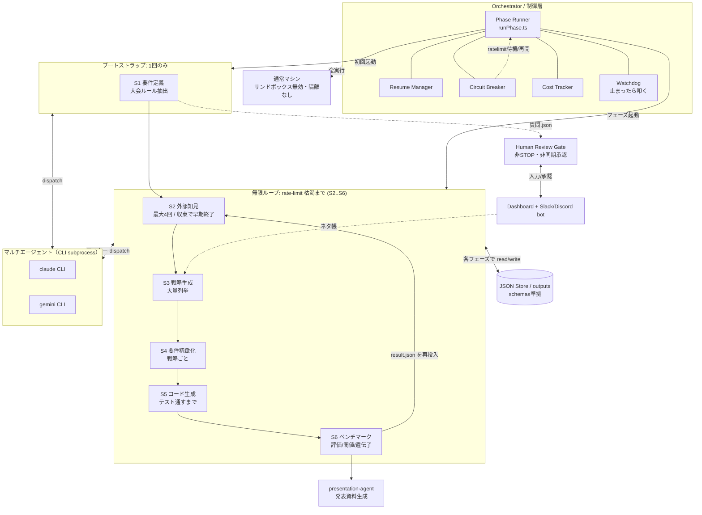
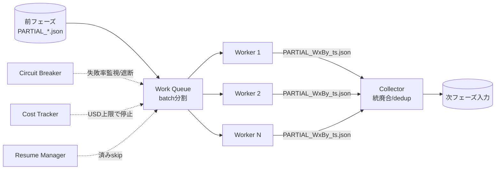
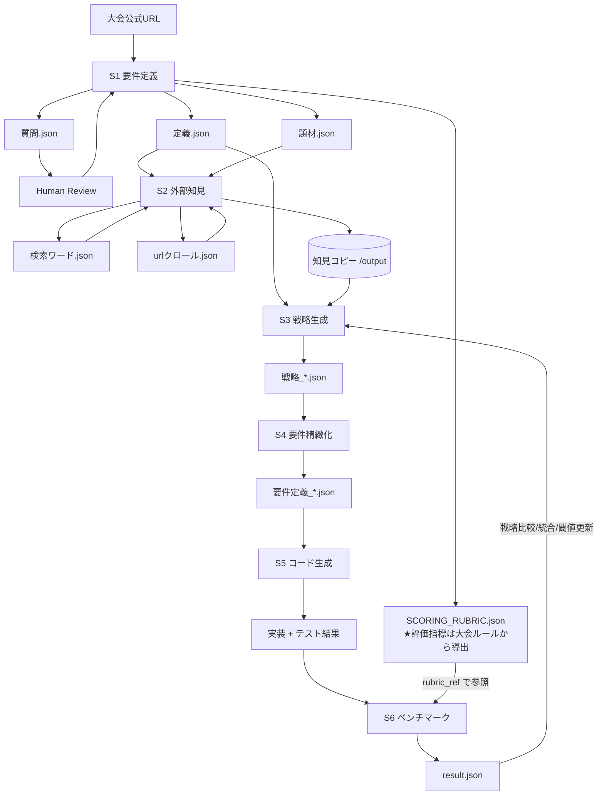

# アーキテクチャ設計 — Taikai-killer

自律 AI ハーネス（要件定義→外部知見→戦略→要件精緻化→コード生成→ベンチマークを無限ループ）の
アーキテクチャを定義する。設計の土台は speca orchestrator（Issue #1）と
[実行環境前提](./execution-premise.md)（通常マシン・サンドボックス無効・隔離なし）。
**確定事項は [decisions.md](./decisions.md) のヒアリング確定が最上位の正。**

---

## 構成

| レイヤ | 採用 / 候補 | 役割 |
|---|---|---|
| Orchestrator | **TypeScript/Node**（speca `scripts/orchestrator/` の Python を移植） | フェーズ実行・並列ワーカー・resume・暴走/コスト制御 |
| Phase Runner | `runPhase.ts` 相当 | 依存解決・cleanup・resume の統一エントリ |
| Agents | **claude / gemini**（CLI subprocess、サブスク認証）。codex/ollama/copilot は将来拡張 | 各フェーズの実作業ワーカー |
| Data Contract | JSON Schema（`schemas/`） | フェーズ間の型付き受け渡し |
| External Knowledge | Scrapling（Python サイドカー）/ Playwright(TS) / fetch | クロール・スクレイプ |
| Optimization | 2トラック: ①数値最適化=LLM不要（GA/ヒルクライムをコードで回す）②構造変異=LLM（S5生成） | 閾値/パラメータ=① / approach=② |
| Dashboard | speca web/ を vendor（FastAPI→TS 書換中 + React/Vite）+ Slack/Discord bot | 状態確認・ヒューマンレビュー入力 |
| Presentation | presentation-agent（Slidev、後で vendor） | 発表資料の自律生成 |
| Host | **通常マシン**（隔離なし・サンドボックス無効・リスク受容） | 実行基盤 |

---

## システム設計図（全体パイプライン）



---

## オーケストレータ内部（ワーカー実行モデル）

speca と同じ「**直列フェーズ＋フェーズ内並列ワーカー＋中間JSON契約**」。



- 各ワーカーは `<phase>_PARTIAL_W{worker}B{batch}_{timestamp}.json` を出力、下流は glob で消費。
- 失敗検知（Circuit Breaker）・予算上限（Cost Tracker）・処理済みスキップ（Resume）を全フェーズ共有。
- ratelimit 到達時は Circuit Breaker が待機→復活検知→再開（README「復活するまで待機して再開」）。
- **CB は3イベントを区別する（流用: SWE-Squad）**: `recordResult(ok)` と別に **`recordSkip(reason)`**。`E_RATELIMIT`・冪等キーhit・親partial欠落の局所スキップ・best-so-far 打ち切りは全て `recordSkip` で**失敗率に加算しない**（「待機・スキップが多い無限ループ」で失敗率が偽膨張し誤トリップ→death spiral になるのを防ぐ）。
- **watchdog は2段（流用: SWE-Squad）**: Tier1=LLM無しの機械修復（orphan reconcile / stall kill→resume / 破損partial rm）→ Tier2=直らない時のみ LLM 自己改善。**Tier2 の LLM 呼び出しは cooldown ロック必須**（`.taikai/locks/self_heal_llm.lock` mtime で最短間隔強制／R2 濫用防止・D5④）。

---

## フェーズ↔JSON データフロー



> **来歴(provenance)**: 上の各 `*.json` は全レコードに `provenance.derived_from`（親レコードID）と `source_ref`（実ソースURL/論文/ファイル）を持つ。下流(result.json)から上流(大会ルール・元論文URL)まで JSON だけで遡れる（データ契約参照）。

---

## 主なデータ契約

```ts
// ★来歴(provenance) — 全レコードが「どこから来たか」を持つ。フェーズを跨いで辿れる。
interface Provenance {
  produced_by: string;        // 生成したフェーズ "S3" / worker など
  agent?: "claude" | "gemini"; // codex/ollama/copilot は将来拡張
  prompt_version?: string;    // どの prompt 版で生成したか（D20）
  derived_from: string[];     // ★親レコードの id（上流の Strategy/CrawledUrl/Requirement…）
  source_ref?: string;        // 元ソースの実体（URL / 論文arXiv id / ファイルパス / 人間入力）
  timestamp: string;          // ISO8601
}

// フェーズ間の共通エンベロープ（全 PARTIAL_*.json が従う）
interface PhaseArtifact<T> {
  id: string;               // このレコードの一意ID（derived_from で参照される）
  phase: string;            // 例 "S2b", "S3", "S6"
  worker: number;
  batch: number;
  timestamp: string;        // ISO8601
  schema_version: string;
  status: "ok" | "partial" | "error";
  provenance: Provenance;   // ★必須 — 来歴チェーン
  payload: T;
}

// S1 要件定義（★評価指標もここで大まかに決まる＝大会依存）
interface Question { id: string; text: string; reason: string; answered?: string; } // 質問.json
interface Definition { term: string; meaning: string; edge_case?: string; }          // 定義.json
interface Subject { theme: string; constraints: string[]; rule_free?: boolean; }     // 題材.json
interface ScoringRubric {                 // SCORING_RUBRIC.json ← S1 が大会ルールから導出
  metrics: { name: string; weight: number; direction: "max" | "min" }[]; // 評価軸と配点
  forbidden: string[];                    // 禁止事項（報酬ハック対策）
  derived_from: string;                   // 由来した大会ルール（TOURNAMENT_INFO / 定義.json の id）
}

// S2 外部知見（source_ref に実ソースを必ず残す）
interface SearchWord { word: string; lang: "ja" | "en"; from: "rule" | "url" | "paper"; } // 検索ワード.json
interface CrawledUrl { url: string; title: string; kind: "web" | "paper" | "arxiv"; saved_path: string; excluded?: "ad" | "nsfw" | null; } // urlクロール.json（provenance.source_ref = url）

// S3 戦略（origin に加え provenance.derived_from で親を辿る）
interface Strategy {
  id: string;
  origin: "requirement" | "result" | "paper" | "subject" | "rival" | "human_idea";
  approach: string;
  merged_from?: string[];   // 類似統合の履歴（統合元の戦略 id）
  // 「どの論文/知見/要件から出たか」は provenance.derived_from / source_ref に記録
}

// S5 コード生成（D22 Reflexion ループの1 attempt。PhaseArtifact<CodeAttempt> payload）
// outputs/{run}/partials/S5_PARTIAL_W{w}B{b}_{ISO8601}.json に attempt 確定ごとに1ファイル append-write
interface CodeAttempt {
  attempt: number;
  code_ref: string;            // 生成コードの保存パス（本体は別ファイル、partial は参照のみ＝slim）
  passed_anchor_ids: string[]; // これまで通過したテストID集合（回帰ガードの対象）
  newly_passed_ids: string[];  // この修正で新規通過（空=進捗ゼロ→stall 判定に使う）
  regressed: boolean;          // 既通過を壊したか→true なら revert 済み
  reverted_to?: number;        // 退行時に戻った attempt 番号
  distance?: number;           // graded distance（MVPは予約のみ・S6/進化段で実装）
}
// S5 の最終結果（Reflexion 系列をプロバナンス化＝D17 と一体、新ファイル無し）
interface CodegenResult {
  strategy_id: string;
  passed: boolean;
  attempts: number;            // 何回で通った/諦めた
  feedbackHistory: string[];   // 各試行の reflector フィードバック（why-retry の証跡）
  finalFeedback?: string;      // 失敗時の最後の教訓
}

// S6 ベンチマーク（README: 6.result.json）
interface BenchResult {
  result_id: string;        // 1 result = S1..S6 の1周
  strategy_id: string;      // どの戦略の結果か（provenance.derived_from にも入る）
  rubric_ref: string;       // ★どの ScoringRubric(=S1由来) で測ったか
  score: number;
  rank: number;             // 現在1位 など
  metrics: Record<string, number>;
  passed_test_ratio: number; // 最小スコアの一次指標
  distance?: number;        // graded distance（direction:min 指標／MVPは予約のみ）
  diff_vs_prev?: number;    // 対照実験の定量差
  threshold: { name: string; value: number }[]; // 閾値・遺伝子セッション
}
```

**来歴チェーンの例**（result.json から大会ルールまで遡れる）:
`BenchResult` → `derived_from: [strategy_id]` → `Strategy.derived_from: [crawledUrl_id, requirement_id]` → `CrawledUrl.source_ref: "https://..."` / `Requirement.derived_from: [definition_id]` → `Definition.derived_from: [tournament_rule]`。
「この戦略はどの論文・どの大会ルールから来たか」「このスコアはどの大会指標で測ったか」を JSON だけで完全に追跡できる（学術再現性 D17 と一体）。

---

## エラー経路

| コード | 条件 | 挙動 |
|---|---|---|
| `E_INPUT` | フェーズ入力 JSON 欠落 / スキーマ不一致 | 当該ワーカーを `status:"error"` で記録しスキップ、他ワーカーは継続 |
| `E_AGENT_CONFIG` | CLI 未認証 / モデル未到達 | そのエージェントを dispatch 対象から除外、残モデルで続行 |
| `E_LLM_COMM` | CLI 失敗 / stdout JSON 不正 / タイムアウト / **returncode 0 だが実質空**（JSON payload 空・必須欠落かつ成果物未生成） | リトライ→CB が遮断（`status:"error"` partial を書いてから次へ）。**exit 0 を盲信しない**（サブスクCLIはエラー時も0で空を返す）。空出力は `consecutive_empty_results` を+1（流用: SWE-Squad） |
| `E_RATELIMIT` | レート上限 | 待機→復活検知→Resume で再開（停止しない。CB の失敗でなく `recordSkip` 扱い） |
| `E_COST` | `budget_usd` 指定時の予算上限到達 | フェーズ停止（**exit 64**）、result を保存して通知。未指定なら発火しない |
| `E_CRAWL` | クロール失敗 / 広告・不適切 | 当該URLを除外（`excluded`）、MCP不安定時は built-in(fetch)へフォールバック、ワード改善ループへ |
| `E_CODE_TEST` | 生成コードがテスト不通過 | **D22 Reflexion ループ**で自己改善再生成（A-1 の具体化＝失敗 input/expected/actual を全文注入し構造化 `fixed_code` 受領→`tsc --noEmit` 検証）。**修正適用後は既通過 `passed_anchor_ids` を必ず再実行し、退行したら直前解に revert＝単調改善を強制**（流用: AlphaCodium）。1試行内は config 駆動の有限キャップで打ち切り **best-so-far を返す**（失敗でなく `recordSkip`。ただし無進捗=`newly_passed` 空の打ち切り連続は D5③ stall でカウント） |
| `E_HOST` | ホスト汚染/破壊検知 | **通常マシン運用のため自動破棄はしない**。検知して通知＋停止、復旧は手動（IaC再作成は任意） |

> 思想: **単一ワーカーの失敗でループを止めない**。失敗は JSON に記録して局所スキップし、
> 全体の無限ループ（速度・自律性）を優先する。停止はレート枯渇・ヒューマンレビューゲート・暴走停止(CB)のみ（コスト上限は任意指定時）。

---

## 関連
- 実行前提: [execution-premise.md](./execution-premise.md)（通常マシン・サンドボックス無効・隔離なし）
- 先行研究/類似OSS: Issue #1（speca orchestrator・presentation-agent・FunSearch ほか）
