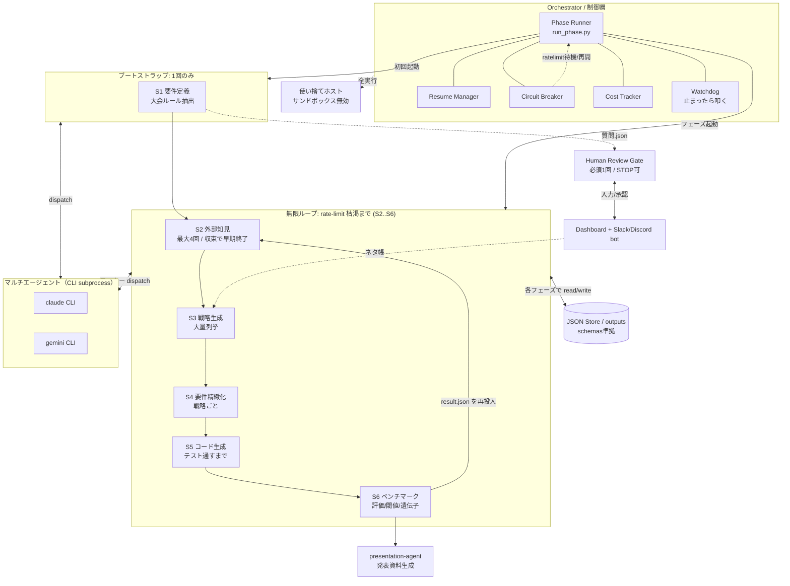
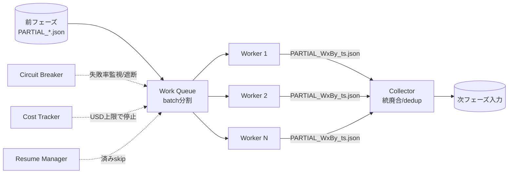
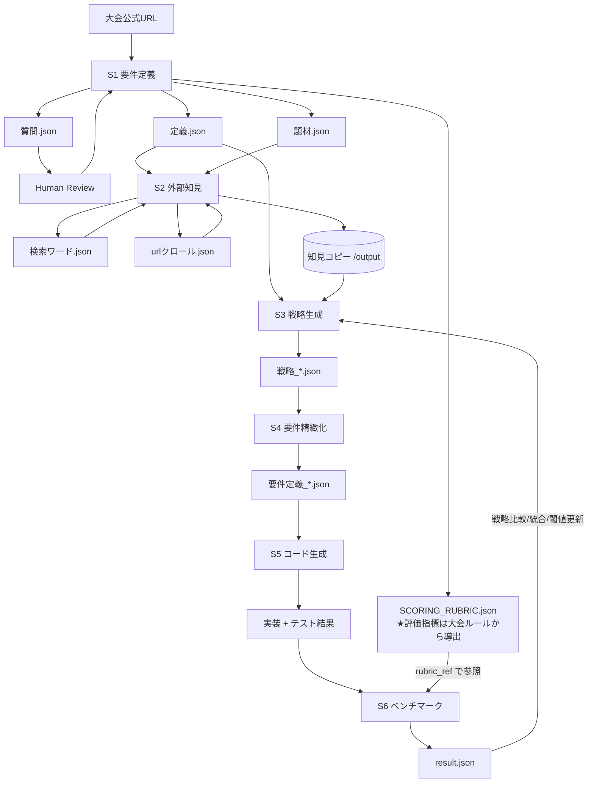

# アーキテクチャ設計 — Taikai-killer

自律 AI ハーネス（要件定義→外部知見→戦略→要件精緻化→コード生成→ベンチマークを無限ループ）の
アーキテクチャを定義する。設計の土台は speca orchestrator（Issue #1）と
[実行環境前提](./execution-premise.md)（サンドボックス無効・マシン破壊前提）。

---

## 構成

| レイヤ | 採用 / 候補 | 役割 |
|---|---|---|
| Orchestrator | Python（speca `scripts/orchestrator/` 流用） | フェーズ実行・並列ワーカー・resume・暴走/コスト制御 |
| Phase Runner | `run_phase.py` 相当 | 依存解決・cleanup・resume の統一エントリ |
| Agents | claude / gemini / codex / ollama / copilot（CLI + MCP） | 各フェーズの実作業ワーカー |
| Data Contract | JSON Schema（`schemas/`） | フェーズ間の型付き受け渡し |
| External Knowledge | Scrapling / playwright-mcp | クロール・スクレイプ |
| Optimization | 進化的探索（FunSearch 系：評価器→交叉/変異） | 戦略・閾値の最適化 |
| Dashboard | Next.js + Slack/Discord bot | 状態確認・ヒューマンレビュー入力 |
| Presentation | presentation-agent（Slidev） | 発表資料の自律生成 |
| Host | 使い捨て VM / VPS / コンテナ | 破壊前提の実行基盤 |

---

## システム設計図（全体パイプライン）



---

## オーケストレータ内部（ワーカー実行モデル）

speca と同じ「**直列フェーズ＋フェーズ内並列ワーカー＋中間JSON契約**」。



- 各ワーカーは `<phase>_PARTIAL_W{worker}B{batch}_{timestamp}.json` を出力、下流は glob で消費。
- 失敗検知（Circuit Breaker）・予算上限（Cost Tracker）・処理済みスキップ（Resume）を全フェーズ共有。
- ratelimit 到達時は Circuit Breaker が待機→復活検知→再開（README「復活するまで待機して再開」）。

---

## フェーズ↔JSON データフロー



> **来歴(provenance)**: 上の各 `*.json` は全レコードに `provenance.derived_from`（親レコードID）と `source_ref`（実ソースURL/論文/ファイル）を持つ。下流(result.json)から上流(大会ルール・元論文URL)まで JSON だけで遡れる（データ契約参照）。

---

## 主なデータ契約

```ts
// ★来歴(provenance) — 全レコードが「どこから来たか」を持つ。フェーズを跨いで辿れる。
interface Provenance {
  produced_by: string;        // 生成したフェーズ "S3" / worker など
  agent?: "claude" | "gemini" | "codex" | "ollama" | "copilot";
  prompt_version?: string;    // どの prompt 版で生成したか（D20）
  derived_from: string[];     // ★親レコードの id（上流の Strategy/CrawledUrl/Requirement…）
  source_ref?: string;        // 元ソースの実体（URL / 論文arXiv id / ファイルパス / 人間入力）
  timestamp: string;          // ISO8601
}

// フェーズ間の共通エンベロープ（全 PARTIAL_*.json が従う）
interface PhaseArtifact<T> {
  id: string;               // このレコードの一意ID（derived_from で参照される）
  phase: string;            // 例 "S2b", "S3", "S6"
  worker: number;
  batch: number;
  timestamp: string;        // ISO8601
  schema_version: string;
  status: "ok" | "partial" | "error";
  provenance: Provenance;   // ★必須 — 来歴チェーン
  payload: T;
}

// S1 要件定義（★評価指標もここで大まかに決まる＝大会依存）
interface Question { id: string; text: string; reason: string; answered?: string; } // 質問.json
interface Definition { term: string; meaning: string; edge_case?: string; }          // 定義.json
interface Subject { theme: string; constraints: string[]; rule_free?: boolean; }     // 題材.json
interface ScoringRubric {                 // SCORING_RUBRIC.json ← S1 が大会ルールから導出
  metrics: { name: string; weight: number; direction: "max" | "min" }[]; // 評価軸と配点
  forbidden: string[];                    // 禁止事項（報酬ハック対策）
  derived_from: string;                   // 由来した大会ルール（TOURNAMENT_INFO / 定義.json の id）
}

// S2 外部知見（source_ref に実ソースを必ず残す）
interface SearchWord { word: string; lang: "ja" | "en"; from: "rule" | "url" | "paper"; } // 検索ワード.json
interface CrawledUrl { url: string; title: string; kind: "web" | "paper" | "arxiv"; saved_path: string; excluded?: "ad" | "nsfw" | null; } // urlクロール.json（provenance.source_ref = url）

// S3 戦略（origin に加え provenance.derived_from で親を辿る）
interface Strategy {
  id: string;
  origin: "requirement" | "result" | "paper" | "subject" | "rival" | "human_idea";
  approach: string;
  merged_from?: string[];   // 類似統合の履歴（統合元の戦略 id）
  // 「どの論文/知見/要件から出たか」は provenance.derived_from / source_ref に記録
}

// S6 ベンチマーク（README: 6.result.json）
interface BenchResult {
  result_id: string;        // 1 result = S1..S6 の1周
  strategy_id: string;      // どの戦略の結果か（provenance.derived_from にも入る）
  rubric_ref: string;       // ★どの ScoringRubric(=S1由来) で測ったか
  score: number;
  rank: number;             // 現在1位 など
  metrics: Record<string, number>;
  diff_vs_prev?: number;    // 対照実験の定量差
  threshold: { name: string; value: number }[]; // 閾値・遺伝子セッション
}
```

**来歴チェーンの例**（result.json から大会ルールまで遡れる）:
`BenchResult` → `derived_from: [strategy_id]` → `Strategy.derived_from: [crawledUrl_id, requirement_id]` → `CrawledUrl.source_ref: "https://..."` / `Requirement.derived_from: [definition_id]` → `Definition.derived_from: [tournament_rule]`。
「この戦略はどの論文・どの大会ルールから来たか」「このスコアはどの大会指標で測ったか」を JSON だけで完全に追跡できる（学術再現性 D17 と一体）。

---

## エラー経路

| コード | 条件 | 挙動 |
|---|---|---|
| `E_INPUT` | フェーズ入力 JSON 欠落 / スキーマ不一致 | 当該ワーカーを `status:"error"` で記録しスキップ、他ワーカーは継続 |
| `E_AGENT_CONFIG` | APIキー未設定 / モデル未到達 | そのエージェントを dispatch 対象から除外、残モデルで続行 |
| `E_LLM_COMM` | LLM 通信失敗 / レスポンス JSON 不正 | リトライ→Circuit Breaker が失敗率で遮断 |
| `E_RATELIMIT` | レート上限 | 待機→復活検知→Resume で再開（停止しない） |
| `E_COST` | USD 予算上限到達 | フェーズ停止、result を保存して人間に通知 |
| `E_CRAWL` | クロール失敗 / 広告・不適切 | 当該URLを除外（`excluded`）、ワード改善ループへ |
| `E_CODE_TEST` | 生成コードがテスト不通過 | 自己改善プロンプトで再生成、通すまで継続 |
| `E_HOST` | ホスト汚染/破壊検知 | 修復せず破棄→再作成→result.json から resume（破壊前提運用） |

> 思想: **単一ワーカーの失敗でループを止めない**。失敗は JSON に記録して局所スキップし、
> 全体の無限ループ（速度・自律性）を優先する。停止は予算上限とヒューマンレビューゲートのみ。

---

## 関連
- 実行前提: [execution-premise.md](./execution-premise.md)（サンドボックス無効・マシン破壊前提）
- 先行研究/類似OSS: Issue #1（speca orchestrator・presentation-agent・FunSearch ほか）
