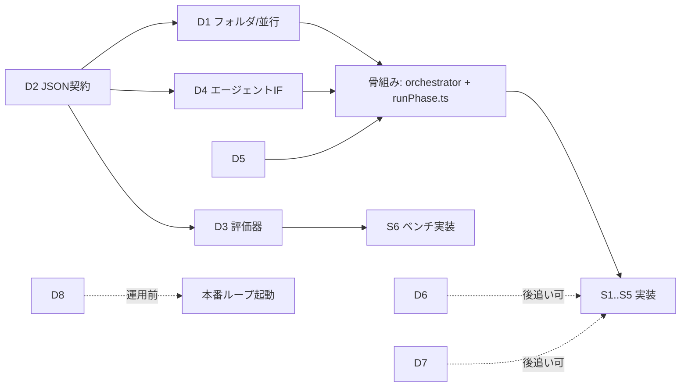

# 設計判断 — 確定事項と固めるべき決定点

現時点の設計を「**確定（Locked）**」と「**要確定（Open＝固めるべき）**」に分けて整理する。
Open は実装着手前に決め切る必要がある順に並べた。各項目に推奨と理由を付す。

関連: [architecture.md](./architecture.md) / [execution-premise.md](./execution-premise.md) / Issue #1

---

## 🔒 ヒアリング確定（2026-06-11）

ユーザー確認で以下を確定。これが最上位の正。

| 項目 | 確定 |
|---|---|
| **スタック** | **TypeScript/Node**（speca を参考に書き換え）。orchestrator も dashboard server も TS。Scrapling クロールのみ **Python サイドカー** |
| **使用モデル** | **Claude + Gemini**、両方**サブスクリプション**（従量課金APIでない）。**CLI を subprocess で叩く**（claude CLI / gemini CLI） |
| **モデル割当（D4）** | フェーズごとに **config で手動指定**（後でベンチ調整） |
| **実行ホスト（D8）** | **使い捨てホスト不要。通常マシンでサンドボックス無効のまま**（隔離なし・リスク受容）。破壊前提は撤回 |
| **対象大会** | **シンギュラリティバトルクエスト ＋ ハッカソン** |
| **評価指標（D3）** | S1 が大会ルールから `SCORING_RUBRIC.json` を導出。最小版=テスト通過率＋実行時間 |
| **レビューゲート（D6）** | **非STOP・非同期承認**（質問.json を dashboard/bot に出し回答で resume） |
| **クロール（D7）** | **Scrapling は Python サイドカー**、JS必須は Playwright(TS)/playwright-mcp、静的は fetch |
| **S2 収束** | 新規ユニーク率 **<10% で停止**（ハードキャップ4回と OR） |
| **状態モデル（D9）** | **partial = resume の唯一の真実源**（glob スキャン）、**append-only イベントログは観測/再現用の write-only**（resume には使わない）。二重管理にしない |
| **冪等キー（D10）** | **入れる**。`hash(prompt全文)` でなく **`hash(phase+worker+batch+親id集合+prompt_version+model)`**（timestamp除外）＝「処理済みマーカー」。出力キャッシュには使わない（LLM非決定のため） |
| **CB しきい値（D11）** | speca 流用＝**連続失敗5 / 総リトライ20 / 連続空出力3 → exit 65** |
| **コスト（D5）** | デフォルト無制限、`budget_usd` 指定時のみ停止（サブスクなので従量課金なし） |
| **再現性（D17）** | 目標は**学会提出レベル**だが、サブスクCLIは seed/temp 固定不可。**達成可能なのは「手続き的再現」**＝全prompt/schema/親partialのhashを固定＋複数trialの分布報告。bit一致再現は放棄、seed/tempは`controllable:false`と明記 |
| **進化（D18）** | **2トラックに分離**: ①**数値最適化＝LLM不要**（閾値/パラメータ/重みを GA/ヒルクライム等の普通のコードで回す。S6評価関数を呼ぶだけ・決定的・無料・高速）②**構造変異＝LLM**（approach/アルゴリズム自体を S5 で生成）。**まず単一プールで開始**、island は後追い。ハーネス指示プロンプトは静的。**評価器D3確定まで起動しない** |
| **dashboard 認証** | speca の API キーログインを**そのまま残す** |
| **presentation-agent** | **後で vendor**（今は参照のみ） |
| **ライセンス** | **非公開/未定**（license ファイル置かない） |

→ これにより D3/D4/D5/D6/D7/D8/D9/D10/D11/D17 が確定、D18 は方針確定。残るのは各 `*.schema.json` 実体化・評価器中身などの**実装タスク**。

---

## ⚖️ 受任したリスク（Accepted Risks）— 2026-06-11

辛口レビューが挙げた「設計以前の前提課題」は、**ユーザー判断で明示的にリスク受任**とする。
未解決の欠陥ではなく**承知の上の選択**として記録する（隠れた前提にしない）。設計はこの前提のまま進める。

| # | リスク | 受任の理由 | 任意の緩和（必須でない） |
|---|---|---|---|
| **R1 出場資格/大会選定** | シンギュラリティバトルクエストが U-18 高校生限定なら、成人の AI 全自動出場は不可。「全部門優勝」が成立しない可能性 | ハーネスの研究・開発価値は**大会非依存**。出場可否は各大会で S1 が `eligibility`/`automation_allowed` を判定する設計に委ねる。狙える大会（成人可・AI支援可のハッカソン/コンペ）に随時切替 | S1 に規約パース（出場資格・自動化可否）を入れ、不可なら起動前に通知 |
| **R2 サブスクCLI自動化の規約** | Claude/Gemini サブスクを無限ループ・並列 subprocess で叩くのは各社の自動化規約に抵触・アカウント停止しうる。「サブスク＝無制限」は厳密には誤り | 研究/テスト用途として進める。アカウント停止は受容コスト | 並列度・頻度の自主制限、必要なら従量課金API＋`budget_usd` に切替可能な抽象を残す |
| **R3 全自動提出の可否** | 多くの大会・ハッカソンは人間参加・AI開示・人間プレゼンを要求。全自動提出は失格/受賞取消になりうる | ハーネスは**戦略探索・実装ドラフト支援**としても価値があるため進める。提出は人間が最終判断（不可逆操作はレビューゲート対象） | `submitted/` は提出前に必ずヒューマンレビューゲートを通す |
| **R4 通常マシン・サンドボックス無効** | 任意生成コードの無限実行でホスト汚染・データ損失。MEMORY の USB 断続切断環境では特に | [execution-premise.md](./execution-premise.md) の通り受容済み。安全は隔離でなく運用ガードで担保 | `outputs/` の別ディスク/クラウド定期バックアップ、S5 のみ任意でコンテナ隔離 |

> **位置づけ**: これらは「直さない」と決めたのではなく「**承知して進む**」決定。状況（大会規約・アカウント停止・データ損失）が顕在化したら再評価する。任意緩和は実装の優先度が上がったときに着手。

---

## ✅ 確定事項（Locked）

| # | 決定 | 根拠 |
|---|---|---|
| L1 | 全体構造は **直列フェーズ S1..S6 ＋ 無限ループ**、1周 = 1 result | README / speca |
| L2 | フェーズ間は **中間 JSON で受け渡し**（全段で出力を残す） | README / speca |
| L3 | Orchestrator は **resume / circuit-breaker / cost-tracker / watchdog** を持つ | speca orchestrator |
| L4 | **マルチエージェント並列＝Claude + Gemini**（CLI subprocess）。codex/ollama/copilot は将来拡張 | ヒアリング |
| L5 | 実行は **通常マシン・サンドボックス無効・隔離なし（リスク受容）**。使い捨てホスト/破壊前提は撤回 | execution-premise.md |
| L6 | 失敗は局所スキップ、**停止はレート枯渇・レビューゲート・暴走停止(CB)のみ**（コスト上限は任意指定時） | architecture.md |
| L7 | 発表資料生成は **presentation-agent（Slidev）** を参考に組み込む | Issue #1 |
| L8 | 戦略・閾値の最適化は **進化的探索（FunSearch 系）** を採用方針 | Issue #1 |
| L9 | **セッション別ループポリシー**（下表）で各 S の回数・停止条件を固定 | 本決定 |

### L9 セッション別ループポリシー

| セッション | ループ方針 | 停止条件 |
|---|---|---|
| **S1 要件定義** | **1回のみ**（ブートストラップ、ループしない） | 1周で完了。以降の result 再入では再実行しない |
| **S2 外部知見** | **最大4回**まで反復 | 4回到達 **or 収束**（新規取得が無く重複が支配的）になった時点で早期終了 |
| **S3 戦略生成** | レートリミット枯渇まで回す | rate-limit 枯渇 / 予算上限 |
| **S4 要件精緻化** | レートリミット枯渇まで回す | rate-limit 枯渇 / 予算上限 |
| **S5 コード生成** | レートリミット枯渇まで回す（テスト通過まで） | rate-limit 枯渇 / 予算上限 / テスト通過 |
| **S6 ベンチマーク** | レートリミット枯渇まで回す | rate-limit 枯渇 / 予算上限 |

- **無限ループの再入は S2 から**（S1 は一度きり）。`result.json` を S2 に再投入して S2..S6 を回し続ける。
- **S2 の収束判定**: 1ラウンドの新規ユニーク率（新規 url / 検索ワード ÷ 取得総数）が閾値未満なら「同じのが出る」とみなし即終了。ハードキャップ4回と OR で早い方。
- 停止の主因は **rate-limit 枯渇**と**予算上限（D5）**。S2 のみ追加で回数キャップ＋収束停止を持つ。

---

## 🔴 固めるべき決定点（Open）— 着手前に決める

### D1. 並行作業モデル：branch か フォルダか ✅確定（[directory-structure.md](./directory-structure.md)）
README で未決だった点。**フォルダ構造で確定**。
- **確定: `projects/<strategy_id>/` の独立フォルダ＋必要時のみ git worktree。branch は使わない。**
- 理由: 戦略を大量並行生成・実装するため、branch 切替コストより独立フォルダの方が並列に強い。speca と同様に雛形(`_skeleton/`)を使い回す。worktree 採用時は共有`.git` commit を直列化＋index.lock retry-backoff（D13）。

### D2. フェーズ間 JSON 契約の厳密度と命名 ✅確定（[directory-structure.md](./directory-structure.md)）
`PhaseArtifact<T>` エンベロープを**正式スキーマとして固定**する。
- **確定: `schemas/` に speca 同型の3+1層（データ型 / `S{n}Partial` / `*Event` / `RunManifest`）を置き、ランナー/CI で検証必須。**
- 命名規約確定: partial = `S{n}_PARTIAL_W{worker}B{batch}_{ISO8601}.json`、run dir = `{ISO8601}-{git短縮hash}-{大会slug}`。
- 残: 各 `*.schema.json` の中身を実装（**＝器は確定だが中身は未実装**。型(TS interface)はあるが JSON Schema 実体・検証ルールは未着手）。

### D3. ベンチマーク評価器の定義 ✅一部確定（評価指標の出所）
- **確定: 評価指標は S1（フェーズ1）が大会ルールから導出する＝大会依存。** S6 で固定の指標を持たず、S1 が `SCORING_RUBRIC.json`（評価軸・配点・禁止事項）を大会ごとに出力し、S6 はそれを `rubric_ref` で参照して測る（[architecture.md](./architecture.md) データ契約）。
  - 流れ: S1 大会ルール抽出 → 大まかな評価指標が判明 → `SCORING_RUBRIC.json` 生成 → S6 がこれで採点。「大会によってこれにする」を仕組み化。
  - フォールバック: ルブリックが薄い/未定の大会では**最小版（テスト通過率＋実行時間）**を既定にし、S1 が上書き可能。
- **S6 は2評価モード（`SCORING_RUBRIC.eval_mode`）**: ①**テスト通過型**（I/Oテスト実行→`passed_test_ratio`）②**対戦型**（戦略同士を round-robin/トーナメントで実際に対戦させ `win_rate` で採点。じゃんけん・ゲームAI等）。どちらかは S1 が大会から導出。**②は LLM 非依存の評価関数**で、数値最適化トラック(D18①)の評価器にそのまま使える（「対戦させて勝った戦略のいいとこを交叉・パラメータを数万回チューニング」が回る）。詳細は [architecture.md](./architecture.md) S6。
- **残（実装で詰める）**: ②閾値の初期値と更新規則 ③遺伝子セッションの交叉/変異の対象（→ D18 の island ハイパラで具体化）④対照実験の比較単位（→ Issue #2 D17 の CI ベース判定）。
- **報酬ハック対策**: `SCORING_RUBRIC.forbidden` に禁止事項を明記し、評価器・テスト改ざんを契約レベルで禁止（Issue #2 TOP3-①）。

### D4. マルチエージェント抽象インターフェース ✅確定
- **確定: Claude + Gemini の2つ、CLI を subprocess で駆動**（サブスク認証をそのまま利用）。codex/ollama/copilot は将来拡張（未実装は exit 2）。
- runtime は **CLI subprocess 型**で統一（speca の HTTP `APIRunner` 階層はサブスク CLI には流用不可。CLI 用に別設計）。CLI は機械可読モード（`--output-format json`/stream-json 等）で叩き、装飾 stdout パースは禁止。各 subprocess に**ハード timeout** 必須、timeout kill 時は `status:"error"` partial を書いてから次へ。
- **✅ 実証済み（リスク済）**: claude/gemini CLI を subprocess で駆動する方式は **speca で実証済み**。実装は vendor 済みの `dashboard/server/services/chat_runtime_cli.py` / `chat_runtime_gemini.py`（Python）を **TS に移植**するだけ＝研究リスクなし・機械的作業。これが `runtimeRegistry.ts` / `claudeRunner.ts` / `geminiRunner.ts` の移植元。
- フェーズ×モデルは config で手動指定。フォールバック順（落ちたら次モデル）も定義。
- **フォールバック判定は OutcomeTracker（コードレベル統計）で持つ**（流用: SWE-Squad）。各 CLI dispatch 直後に `record({phase,agent,success,emptyResult,durationMs,error})`、agent ごと `consecutiveFailures>=3` で `isAgentHealthy=false`→そのフェーズの dispatch 対象から外し残モデルへ。状態は `outputs/{run}/AGENT_HEALTH.json`（状態DB禁止と整合）。LLM の都度判断でなくローリング統計で E_AGENT_CONFIG/E_LLM_COMM を発火。

### D5. レート/コスト制御ポリシー ✅確定
- **確定: 予算上限は必須にしない。標準＝無制限**（README「レートリミットの続く限り無限でおこなう」と一致）。コスト上限は**任意で指定できる opt-in**。
  - **未指定（デフォルト）**: 無制限。停止条件は**レート枯渇 ＋ ヒューマンレビューゲート ＋ 暴走停止（CB）**のみ。`BudgetExceeded`(exit 64) は発火しない。
  - **指定時**: `SCORING_RUBRIC.json` / 設定で `budget_usd`（result 単位 or 日次）を渡せる。超過で result を保存して通知し停止（`E_COST` / exit 64）。`cost_tracker` は常に**追跡はする**（指定が無くても可視化はする）が、**強制終了は上限指定時のみ**。
- **②ratelimit 復帰戦略**: `E_RATELIMIT` は失敗にカウントせず、指数バックオフで待機→復活検知→resume。または別モデル（Claude↔Gemini）に切替。
- **③暴走停止条件**: コストではなく **CB の3カウンタ**（連続失敗5 / 総リトライ20 / 連続空出力3 → exit 65）で止める（無制限運用でも暴走は止まる）。**ただし「非空だが無進捗」（score/rank が N ラウンド改善せず）も stall として検出する必要あり＝実装課題**。
- **④自己修復の段階化（流用: SWE-Squad）**: watchdog「止まったら叩く」を2段に分ける。**Tier1=LLM無しの機械修復**（orphan PID reconcile / log mtime stall→kill→resume / 破損 partial rm→batch粒度resume）。**Tier2=直らない時のみ LLM 自己改善**。**Tier2 の LLM 呼び出しは cooldown ロック必須**（`.taikai/locks/self_heal_llm.lock` の mtime で最短間隔強制）。これが無いと「LLM自己修復→また失敗→またLLM」がサブスク枠を焼く（R2 濫用に直結）。
- ⚖️ **前提リスク（受任済み R2）**: サブスク CLI を無限ループ・並列 subprocess で叩くのは各社の自動化規約に抵触しうるが、リスク受任で進める（→ 受任リスク表 R2）。並列度・頻度の自主制限／従量課金API切替の余地は抽象に残す。自己修復の LLM cooldown ロック（D5④）はこの濫用を抑える具体策。

### D6. ヒューマンレビューゲートの実装 ✅確定
- **確定: 非STOP・非同期承認**。STOP せず `質問.json` を Dashboard/bot に出し、回答が来たら resume で反映（README「後でも行える」に合致）。
- 入力経路は vendor 済み dashboard（speca の承認フロー `chat_approvals`/ApprovalCard を流用）＋ Slack/Discord bot。

### D7. 外部知見クロールのフォールバック確定 ✅確定
- **確定: 論文= Semantic Scholar API を一次経路**（arXiv export は egress IP で 503 ブロック実績／Issue #1）。一般Web= **Scrapling（Python サイドカー）**、JS必須サイト= Playwright(TS)/playwright-mcp、静的= fetch。MCP 不安定時は built-in にフォールバック（steal D-3）。
- ⚠️ 歩留まり前提（レビュー指摘）: ブロック/robots/bot検知で成功率は想定の数分の一。「大量に集める」より**少数の良質ソースを深く読む**＋API一次経路に寄せる方針。robots/ToS 遵守・低頻度・キャッシュ前提。

### D8. 実行ホスト ✅確定（撤回）
- **確定: 使い捨てホストは使わない。通常マシンで実行**（[execution-premise.md](./execution-premise.md)）。破壊前提・IaC再作成は撤回。破壊検知時は自動破棄せず通知＋停止、復旧は手動。
- ⚖️ レビュー指摘（受任済み R4）: 通常マシンでサンドボックス無効＋S5 生成コード実行は自己破壊リスクだがリスク受任（→ 受任リスク表 R4）。任意緩和として S5 のみコンテナ隔離・`outputs/` バックアップは優先度が上がれば着手。

### D22. S5 自己改善 = Reflexion ループ ✅確定（流用: faveos8758/reflexion-agent-ts, MIT [integrations](./integrations-issue1.md)）
- **確定: S5 の自己改善はこの単一ループを唯一の正式契約とする。** `execute(CLI生成) → evaluator(テスト実行→{passed,reason}) → reflector(失敗理由→改善指示) → 改善プロンプトで retry`、`maxAttempts`（MVP=3）。
  - steal A-1「同一プロンプト単純リトライ禁止・内容を変えて再生成」の**中身（reflector による失敗理由→改善指示）**を埋める実装契約。
  - directory-structure の `prompts/S5_eval_optimizer.md` に残る**未定義「D21」番号は D22 に統合・改名**（evaluator-optimizer と Reflexion は S5 では同一ループの別名、二重契約にしない）。
  - モデル呼び出しは **`runtimeRegistry.runCLISubprocess` を1 seam として共有**（ai/Vercel SDK 依存は持ち込まない。D4 と二重化させず実装メモ扱い）。
  - `maxAttempts` 到達＝その item を `success:false` で partial に書いて次へ（局所スキップ）。CB（phase 横断）とは独立。`E_RATELIMIT` は attempt 失敗にカウントしない。
  - **reflector は MVP 既定 = LLM**（品質確保）。rate 枯渇頻発時のみ config フラグで決定的テンプレ reflector に切替（reflector の CLI 呼び出しを省く opt-in 緩和）。
  - 取込 MIT コードは `vendor/reflexion-agent-ts/` に元 LICENSE 同梱（本体は license 無しのまま）。

---

## 着手順（依存関係）

**最初に固める3点: D2(契約) → D1(フォルダ) → D3(評価器)。** ここが決まれば orchestrator 骨組みに着手できる。

---

## 次アクション
- [ ] D2: `schemas/` に `PhaseArtifact` ＋ 各 payload の JSON Schema を起こす
- [ ] D1: `projects/<strategy_id>/` テンプレ構成を確定
- [ ] D3: 最小スコア（テスト通過率＋実行時間）＋ 評価器 IF を定義
- [ ] D4: ワーカー dispatch アダプタ（CLI/MCP）とフォールバック順を定義
- [ ] speca orchestrator を fork/vendor して骨組みに流用（Issue #1）
